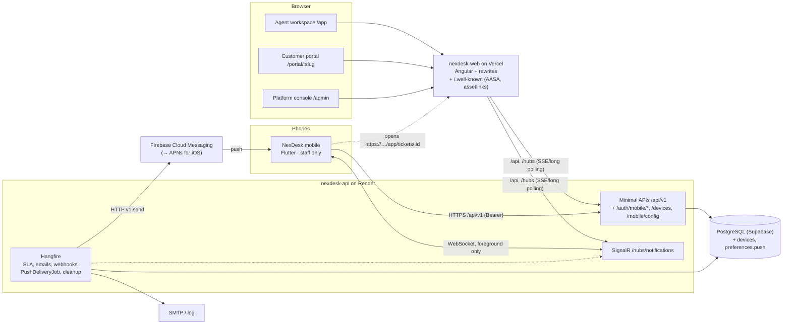

# NexDesk Mobile

The Flutter app for **NexDesk** support teams. Agents triage their inbox, reply and add internal notes with
@mentions, attach photos, and get a push when a ticket needs them, in English or Arabic, on Android and iOS.
It talks to the same API as the web app ([nexdesk-api](https://github.com/mahmoudadel810/nexdesk-api));
customers keep using the web help centre ([nexdesk-web](https://github.com/mahmoudadel810/nexdesk-web)).

## Features

- **Inbox**: Mine, Unassigned, SLA (breached and at risk) and All, the saved views from the web, search
  (a ticket number lists that ticket first), paging, pull to refresh, and the last pages kept for offline
  reading. On tablets the open ticket sits beside the list.
- **Ticket**: the header with live SLA countdowns, and a timeline with internal notes set apart. The
  composer writes a reply or a note, with @mention suggestions, a draft kept per ticket (it survives the
  app being killed) and "send and set status". The actions sheet covers status, priority, tags, assign and
  watch. When someone else changed the ticket first, a banner reloads it and offers "Apply mine again".
  Viewers read only.
- **Attachments**: camera, photo library and files. Photos are sent as JPEG at most 2048 px on the long
  edge (a 12 MP photo becomes about 400 KB, and HEIC is converted). The 10 MB limit and blocked file types
  are checked before uploading. Uploads show progress and can be cancelled. Files in the timeline open in
  the phone's own viewer.
- **Live**: while the app is open, others' changes appear without a refresh, and a banner says when you
  were mentioned or assigned. The notification centre uses the web's wording, with an unread badge and
  mark read / mark all read.
- **Push and links**: pushes for assignments, replies, notes, mentions and SLA warnings and breaches, in
  the account's language and without message text on the lock screen. Tapping one opens the ticket, after
  sign-in if needed. Ticket links in notification emails open in the app.
- **New ticket** for requests that came by phone, chat or in person, with customer search by email.
- **Profile**: availability, language (saved on the account, so the web and emails follow), theme,
  per-event notification settings (in the app, email, phone), and an app lock with fingerprint, face or
  screen lock that asks again after 5 minutes away. The app switcher shows a cover, never ticket content.
- **Arabic** throughout, right to left, switching with no restart.

## How it fits



### Sign-in, refresh and push

```mermaid
sequenceDiagram
    autonumber
    participant M as Mobile app
    participant K as Keychain / Keystore
    participant A as API
    participant D as Database
    participant J as Hangfire
    participant F as FCM / APNs

    M->>A: POST /auth/mobile/login {email, password}
    A->>D: verify password, lockout, workspace status; store hash of new refresh token (family F1)
    A-->>M: {accessToken (15 min, sid=F1), refreshToken, expiries, session}
    M->>K: save refreshToken (access token stays in memory)
    M->>A: PUT /devices/{installationId} {platform, fcmToken} (Bearer)
    A->>D: upsert device (tenant, user, family F1), drop the same token on other accounts

    Note over M,A: 15 minutes later: single-flight refresh
    M->>K: read refreshToken
    M->>A: POST /auth/mobile/refresh {refreshToken}
    A->>D: atomic claim: revoke old, store successor (still F1)
    A-->>M: new access token + new refreshToken
    M->>K: overwrite refreshToken before any use

    Note over A,D: A reused (already rotated) token revokes all of F1

    Note over A,F: A teammate assigns ticket #42 to this user
    A->>A: TicketAssigned → Notifier: InApp row? Email? Push (preference.push != false)?
    A->>J: enqueue PushDeliveryJob(tenant, user, #42)
    J->>D: devices of user WHERE family has a usable token; unread count
    J->>F: messages:send {title "#42 assigned to you", body subject, data {ticketId, link}}
    F-->>M: notification (lock screen shows no message text)
    M->>M: tap → go_router /app/tickets/{id} (after unlock / refresh)
    M->>A: GET /tickets/{id}, /timeline
```

### The session

- The refresh token is kept in the Keychain or Android Keystore; the access token only in memory.
- Every request goes through one interceptor: it adds the bearer token, refreshes a minute before expiry,
  refreshes once and replays on a `401`, signs out on a second `401`, and waits out a `429` for reads.
- Refreshes are single-flight: ten requests with an expired token make one refresh call. The API treats a
  refresh token used twice as stolen, so overlapping refreshes would sign the phone out.
- `invalid-refresh-token` signs out quietly ("Your session ended"); `tenant-suspended` and
  `account-disabled` show a blocked screen; platform admins are sent to the web.
- On launch the app checks `GET /mobile/config` and asks for an update if its build is too old.
- Signing out removes the device from push, revokes the sign-in, and wipes secure storage, the database
  and the file cache.

### Live updates

The SignalR connection is open only while the app is on screen. It closes 30 seconds after the app leaves,
or as soon as the phone cuts the network (Android does within seconds), and reconnects with back-off (0, 2,
5, 10, then every 30 seconds). SignalR does not replay what was missed, so every (re)connect reloads the
unread count, the open ticket and the visible list. In the background, pushes take over.

## Stack and decisions

| Concern | Choice | Why |
|---------|--------|-----|
| Framework | Flutter 3.50 (pinned in `.fvmrc`) | One codebase for Android and iOS, with first-class right-to-left support. |
| State | Riverpod 3 | Testable providers, overridden with fakes in every test. |
| Navigation | go_router, with the web's paths (`/app/tickets/:id`) | Links from emails and pushes open the same place on the web and in the app. Flutter's built-in deep linking feeds them in; no extra plugin. |
| API | A Dio client generated by swagger_parser from a committed OpenAPI snapshot | Types follow the API exactly; `verify.sh` fails when the generated code is stale. |
| Cache | drift (SQLite) for lists, tickets and drafts; the OS cache directory for files | A view cache, not a replica: no sync engine to get wrong. |
| Real time | signalr_netcore over WebSockets, foreground only | The same hub the web uses. Push covers the background; the app also works with live updates off. |
| Push | FCM on both platforms (APNs through FCM) | One sender, token type and credential on the server. Optional at build time. |
| App lock | local_auth (fingerprint, face or screen lock) | The screen lock is accepted too, so a failed fingerprint does not shut anyone out. |
| Tests | flutter_test (unit, widget, golden, accessibility) and Maestro | Maestro flows run against the real API on an emulator. |

The full plan with every decision and the delivery steps 16.1 to 16.12 is
`docs/phase-16-mobile-plan.md` in the NexDesk workspace.

## Quick start

You need Flutter 3.50, Java 17, the Android SDK and Maestro. `scripts/env.sh` looks for them in
`~/dev-tools` (`flutter/`, `jdk-17/`, `android-sdk/`) and otherwise uses what is on `PATH`.

1. Start the API with demo data, from [nexdesk-api](https://github.com/mahmoudadel810/nexdesk-api):

   ```bash
   docker compose up -d --build
   docker compose run --rm api --seed
   ```
2. Start an Android emulator, then run the app:

   ```bash
   source scripts/env.sh
   flutter pub get
   flutter run --flavor dev -t lib/main_dev.dart
   ```

The `dev` flavor (`app.nexdesk.mobile.dev`, "NexDesk Dev") calls `http://10.0.2.2:8080`, which is the API
on your machine as seen from the emulator. Pass `--dart-define=API_BASE_URL=http://<your-ip>:8080` for a
phone on your network. The `prod` flavor (`app.nexdesk.mobile`) calls `https://nexdesk-api.onrender.com`
over HTTPS only.

### Demo accounts

All with the password `NexDesk-demo-2026`:

| Account | Who |
|---------|-----|
| `maya@brightpath.demo` | Agent at BrightPath Software, English: the main demo |
| `tom@brightpath.demo` | Agent, for @mentions |
| `daniel@brightpath.demo`, `sarah@brightpath.demo` | Admin and owner, on the web |
| `finance@brightpath.demo` | Viewer: reads, cannot change anything |
| `layla@souqna.demo`, `noor@souqna.demo` | Owner and agent at Souqna, Arabic |
| `casey@customers.demo` | A customer, in the web help centre |

### Push

Push needs a Firebase project. Put each flavor's `google-services.json` (and `GoogleService-Info.plist` for
iOS) in `~/.config/nexdesk-mobile/<flavor>/`; `scripts/firebase-config.sh` copies them in before builds,
and they are never committed. Run the API with `Push__Provider=Fcm` and the project's service account.
Without a config the app builds and runs with push off, and its notification settings say so.

## Tests

```bash
scripts/verify.sh          # generated code, format, l10n keys, directional layout, analyze, tests
scripts/verify.sh --e2e    # plus: build the dev app and run every Maestro flow on a running emulator
```

- **Unit and widget tests** run against a fake API and fake platform services (camera, files, biometrics,
  push, the live connection), including the session's single-flight refresh, the realtime lifecycle on a
  fake clock, and push and link routing.
- **Accessibility**: every main screen is checked at 200% text size (an overflow fails) and against
  Flutter's tap target, label and contrast guidelines.
- **Goldens** of sign-in, the inbox (light and dark, both directions) and the Arabic new-ticket form are in
  `test/goldens/`; refresh them on purpose with `flutter test --update-goldens`.
- **Maestro** (`e2e/`) drives the dev app against the seeded local API: sign-in, Arabic, inbox tabs and
  search, reply and note, Tom's mention notification, photo attachment, live updates, new ticket, language
  switch, push tap routing, a deep link while signed out, the draft surviving a kill, and the viewer's
  read-only ticket. Scripts in `e2e/scripts/` check results through the API, such as Tom's notification
  or the stored photo's size. `e2e/suites/full_demo.yaml` chains them all.
- `scripts/check-directional.sh` rejects left/right spacing in `lib/`, so the Arabic layout mirrors;
  `scripts/check_l10n.dart` fails when a message is missing from either language.

## Release

- **Android**: `flutter build appbundle --flavor prod -t lib/main_prod.dart` signs with the upload key in
  `~/.config/nexdesk-mobile/key.properties`. From `android/`, `fastlane internal` builds the bundle and
  sends it to Play internal testing, with the Play service account in
  `~/.config/nexdesk-mobile/play-service-account.json`.
- **iOS**: `codemagic.yaml` builds on Codemagic's Macs and uploads to TestFlight. It is started by hand,
  not on push.
- **Store screenshots**: `scripts/store-screenshots.sh` captures the main screens in English and Arabic
  into `build/store/`.

## The API client

`openapi/nexdesk-v1.json` is a committed snapshot of the API's document, and `lib/core/api/generated/` is
generated from it. After an API change, with the API running locally, run `scripts/update-api.sh` and
commit both. Screens use repositories that wrap the generated client, never the generated types directly.

## Layout

```
lib/
  main_dev.dart, main_prod.dart   one entry point per flavor
  app/                            app widget, router, theme, lock gate, push routing, startup
  core/                           api, auth (session), cache, errors, l10n, lock, push, realtime
  features/<feature>/             data, application and presentation: inbox, ticket, attachments,
                                  notifications, profile, auth, shell
  shared/                         widgets used across features
test/                             unit, widget, golden and accessibility tests
e2e/                              Maestro flows, their API scripts, and suites
scripts/                          verify, update-api, firebase-config, e2e fixtures, store screenshots
```

## History

The app was built in Phase 16, steps 16.4 to 16.12, after the API (16.1 to 16.3) gained mobile sign-in,
devices and push, `GET /mobile/config`, and the app-link files on the web. Each step is a merge commit on
`main`.
